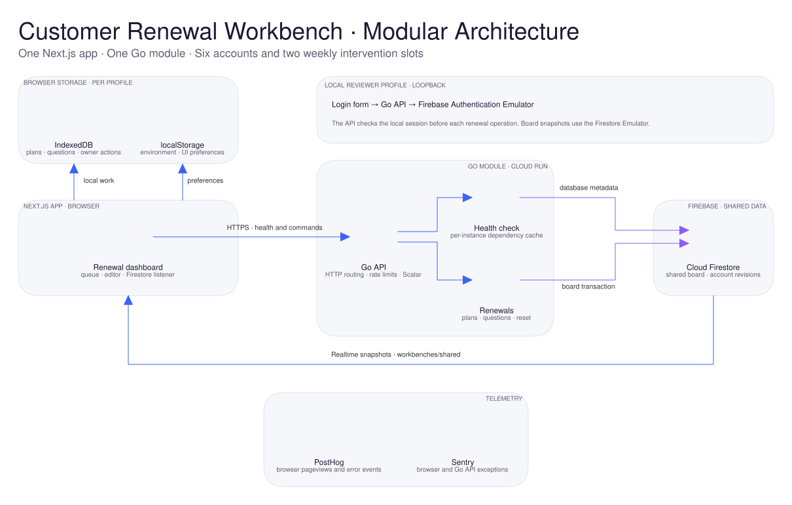
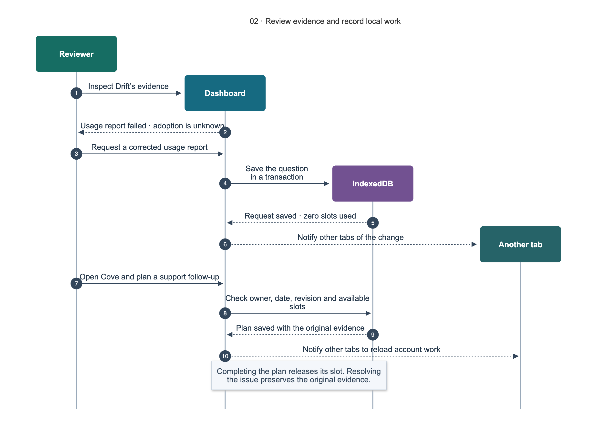
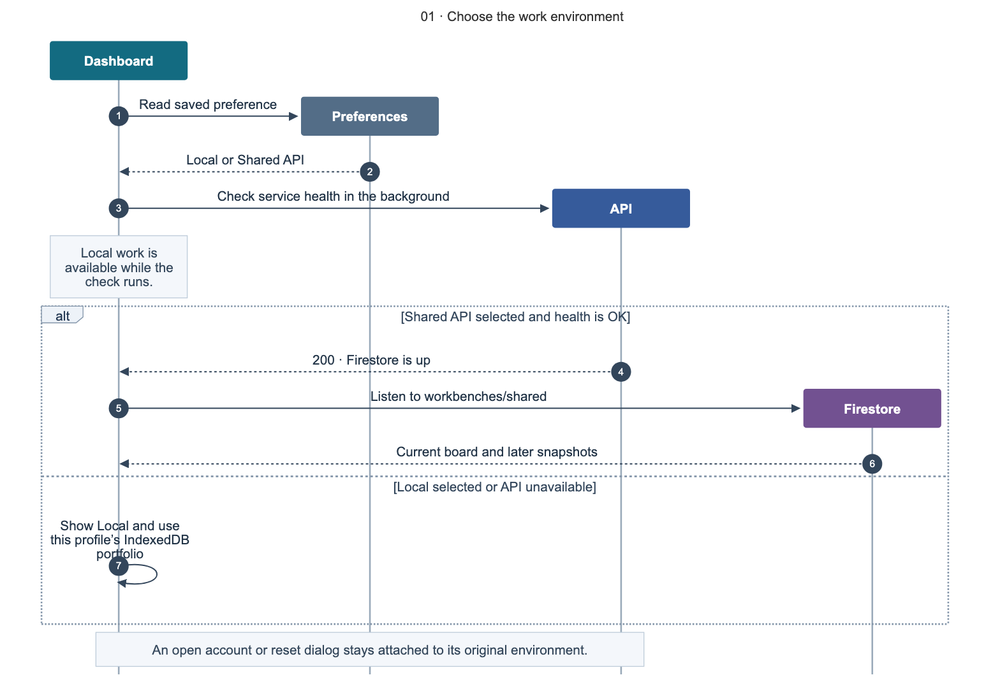
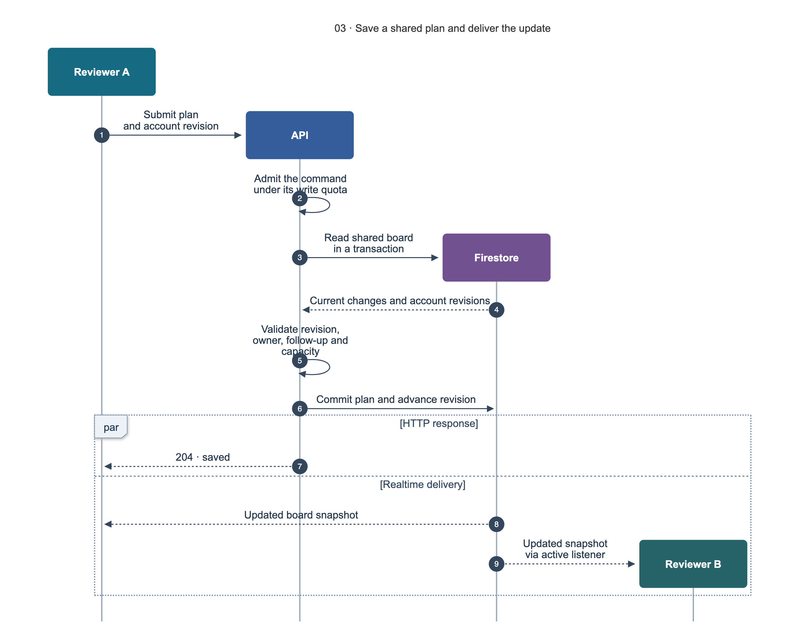

# Customer Renewal Workbench

**TL;DR** — A Customer Success manager oversees 40 accounts and can help two this week. This Hacker Eval prototype uses six fictional B2B accounts to show how the manager can review renewal evidence, choose interventions, and assign follow-ups. The head of Customer Success is the buyer.

- [Live dashboard](https://customer-renewal-workbench.vercel.app/)
- [Live API](https://renewal-api-809086370856.us-central1.run.app/)
- [Frontend guide](frontend/web/README.md)
- [Backend guide](backend/api/README.md)
- [Project plan](docs/PLANS/0-START/plan.excalidraw)
- [Plan preview · Delivered and At scale](docs/PLANS/0-START/plan.svg)

## Table of contents

- [Architecture](#architecture)
  - [Local and shared writes](#local-and-shared-writes)
- [Run locally](#run-locally)
- [Renewal flows](#renewal-flows)
  - [Local mode](#local-mode)
  - [Shared API mode](#shared-api-mode)
- [Starting portfolio](#starting-portfolio)
- [Decision rules](#decision-rules)
- [Reviewer walkthrough](#reviewer-walkthrough)
- [Persistence and scope](#persistence-and-scope)
- [Decision trade-offs](#decision-trade-offs)
  - [Delivered and at scale](#delivered-and-at-scale)
  - [Product and workflow](#product-and-workflow)
  - [Browser and shared data](#browser-and-shared-data)
  - [Delivery and operations](#delivery-and-operations)
- [Monthly costs](#monthly-costs)
- [Verification and attribution](#verification-and-attribution)

## Architecture

**IndexedDB powers both Local mode and the fallback when the API is unavailable.** The dashboard opens the browser’s local portfolio while it checks the API in the background. Reviewers can inspect accounts, save plans and record questions locally, and their work survives a refresh in the same browser profile.

When the API recovers, a reviewer who previously selected **Shared API** returns to the shared portfolio once the health check succeeds, the browser receives a fresh Firestore snapshot, and any open Local editor or reset dialog is closed. If the shared board cannot be read, the dashboard uses Local while the browser retries in the background. Firestore supplies the latest shared state, and new shared edits go through the API. Work saved during fallback stays in IndexedDB and is available again under **User menu → Environment → Local**.

[](docs/ARCHITECTURE/architecture.svg)

[Editable Excalidraw source](docs/ARCHITECTURE/architecture.excalidraw)

### Local and shared writes

A local save validates the account revision and weekly capacity in an IndexedDB transaction. A shared save makes those checks in a Firestore transaction. An open editor keeps its original environment if connectivity changes. [API guide](backend/api/README.md)

## Run locally

Use Node.js 22.12+ and pnpm 10. Run these commands from the repository root.

```sh
pnpm install --frozen-lockfile
pnpm dev --filter=renewal-workbench-web
```

To start both services, install the Go version in [backend/api/go.mod](backend/api/go.mod) and run `pnpm dev`. See the [API guide](backend/api/README.md) to configure the shared Firestore workbench.

Open the [local dashboard](http://127.0.0.1:3000/). The [frontend guide](frontend/web/README.md) covers the folder structure, build, and telemetry setup.

## Renewal flows

### Local mode

Choose **Local** under **User menu → Environment** to try the workflow in one browser profile. Request a usage report for Drift, save a plan for Cove, then refresh the dashboard. IndexedDB keeps both decisions available even when the API is down. A local reset clears the work saved in that profile.

<p align="center">
  <strong><a href="docs/ARCHITECTURE/steps/02-local-work/">Record local work</a></strong><br>
  Request missing evidence for Drift and save an intervention for Cove. Only the intervention uses a slot.<br>
  <a href="docs/ARCHITECTURE/steps/02-local-work/SEQUENCE.txt">Mermaid source</a><br><br>
  <a href="docs/ARCHITECTURE/steps/02-local-work/diagram.png"></a>
</p>

### Shared API mode

Once the health check succeeds, choose **Shared API** in two browser profiles. Save a plan in one and watch it appear in the other. The API validates the change and Firestore delivers the committed board to both browsers. The same shared board determines who gets the last slot and what everyone sees after a reset.

<p align="center">
  <strong><a href="docs/ARCHITECTURE/steps/01-environment/">Choose an environment</a></strong><br>
  The dashboard checks API health in the background while the local portfolio is available.<br>
  <a href="docs/ARCHITECTURE/steps/01-environment/SEQUENCE.txt">Mermaid source</a><br><br>
  <a href="docs/ARCHITECTURE/steps/01-environment/diagram.png"></a>
</p>

<p align="center">
  <strong><a href="docs/ARCHITECTURE/steps/03-shared-write/">Save a shared plan</a></strong><br>
  One browser submits the command. Both reviewers receive the committed plan from Firestore.<br>
  <a href="docs/ARCHITECTURE/steps/03-shared-write/SEQUENCE.txt">Mermaid source</a><br><br>
  <a href="docs/ARCHITECTURE/steps/03-shared-write/diagram.png"></a>
</p>

<p align="center">
  <strong><a href="docs/ARCHITECTURE/steps/04-last-slot/">Claim the final weekly slot</a></strong><br>
  With one active plan, two reviewers submit different accounts. Only one can take the remaining slot.<br>
  <a href="docs/ARCHITECTURE/steps/04-last-slot/SEQUENCE.txt">Mermaid source</a><br><br>
  <a href="docs/ARCHITECTURE/steps/04-last-slot/diagram.png"></a>
</p>

<p align="center">
  <strong><a href="docs/ARCHITECTURE/steps/05-shared-reset/">Reset the shared portfolio</a></strong><br>
  One confirmation restores all six accounts for everyone in Shared API mode. A second reset within 60 seconds returns a retry delay.<br>
  <a href="docs/ARCHITECTURE/steps/05-shared-reset/SEQUENCE.txt">Mermaid source</a><br><br>
  <a href="docs/ARCHITECTURE/steps/05-shared-reset/diagram.png"></a>
</p>

## Starting portfolio

Renewal dates are relative to today in the browser’s time zone. Adoption is the share of licensed users active that week.

| Account | ACV (USD) | Renews in | Adoption | Evidence |
| --- | ---: | ---: | --- | --- |
| Atlas | $100,000 | 45 days | 85% | Positive sponsor and no unresolved issue |
| Beacon | $18,000 | 14 days | 70% → 20% | Sponsor unreachable |
| Cove | $80,000 | 21 days | 80% | Critical issue open and sponsor positive |
| Drift | $40,000 | 30 days | Unknown | Usage report failed and sponsor sentiment unknown |
| Ember | $55,000 | 7 days | 35% | Budget approval pending |
| Field | $25,000 | 60 days | 65% | Issue resolved and sponsor positive |

One defensible choice is **Ember and Cove**. For Ember, identify the budget approver and confirm the decision date. For Cove, agree on a resolution date with support and schedule a sponsor update. Beacon is a viable alternative while the cause of the adoption drop is investigated.

## Decision rules

- **Review now** applies to an open critical issue, pending budget approval within 14 days of renewal, or an adoption drop of at least 30 percentage points with an unreachable sponsor. An active plan leaves this status in place. Completing the plan changes it to **Reviewed** while the same concern persists.
- When none of those rules applies, missing usage or unknown sentiment yields **Needs information**. Otherwise, an active intervention yields **Follow-up planned**, and the default is **Routine review**. Within each group, the queue sorts by earliest renewal.
- A committed intervention uses one slot per account and requires evidence, an owner, and a follow-up by the renewal date. Edits keep the same slot, information requests use zero, and completing a plan frees its slot. Resolving a concern updates the current signal while preserving the plan’s original evidence.

## Reviewer walkthrough

Start in a fresh browser profile and select **Explore on my own** to follow the steps below.

1. Open **Cove** and check its critical issue alongside 80% adoption and positive sponsor sentiment. Open **Drift**, verify **Unknown** adoption, and save an information request for a corrected usage report. The slot count stays at zero.
2. Save a **Cove** intervention with an owner and a follow-up two days from today. Check that a missing owner blocks saving and the calendar disables dates after renewal. Reload and reopen the plan to verify the saved evidence, owner, and date.
3. Under Cove’s **Owner actions**, mark the critical issue resolved. Cove moves to **Follow-up planned**, retains the original plan evidence, and still occupies one slot.
4. Save an **Ember** plan to fill the second slot. Ember stays **Review now**. Try saving **Beacon** and verify the limit. Edit Ember’s owner and check that the count stays at two.
5. Complete Ember’s intervention. It moves to **Reviewed** with budget approval still pending. Reload to verify that status, then use the free slot for Beacon. Complete Cove’s plan and check that Cove returns to **Routine review** and still shows the completed plan.
6. Search for an absent account and recover with **Show all accounts**. Toggle the dashboard’s 30-day renewal filter. Press Escape in an account dialog and verify focus returns to the trigger. In Local mode, an independent browser profile starts with zero saved plans.

## Persistence and scope

**Local** saves work in IndexedDB for the current browser. **Shared API**, available under **User menu → Environment**, shares the six accounts across browsers. The dashboard listens to Firestore and sends every change to the Go API. Both modes check account revisions and enforce the two-slot limit transactionally.

**Reset workbench** restores the starting portfolio in the selected environment. In API mode it clears everyone’s plans, questions and owner updates after confirmation. The Local portfolio stays separate when switching modes or falling back to Local. The shared demo is public and intended for fictional data.

**Proposed success metric** — Share of accounts renewing within 30 days with a plan saved before renewal that cites a signal, names an owner, and schedules follow-up by renewal. The starting denominator is Beacon, Cove, Drift, and Ember. The dashboard measures planning coverage. Measuring renewal impact would require outcome data and a comparison.

## Decision trade-offs

### Delivered and at scale

[](docs/PLANS/0-START/plan.svg)

Read each row across. The right column describes an option and the condition that would justify it. [Full visual plan](docs/PLANS/0-START/plan.svg) · [Editable source](docs/PLANS/0-START/plan.excalidraw)

| Delivered | At scale |
| --- | --- |
| Six fictional renewals share two intervention slots. Evidence, an owner and a follow-up date make each choice reviewable. | When teams manage separate portfolios, use contractual dates and allocate capacity per team and planning period. |
| IndexedDB keeps Local mode usable through an API outage. Local edits stay in that browser when the shared board returns. | If reviewers need offline submissions, queue only edits intended for sharing and resolve conflicts against current account revisions and capacity. |
| The API writes one shared document in a transaction. Every subscribed browser receives the committed board. | If contention or listener traffic grows, split accounts into documents, narrow subscriptions and reserve capacity in the same transaction as the plan. |
| Anyone can reset the public demo after confirmation, subject to a shared cooldown. | Before onboarding real customers, scope reads and writes to authenticated workspace members and restrict reset permissions. |

### Product and workflow

| Decision | What we gain | Cost and when to revisit |
| --- | --- | --- |
| Six fictional accounts in a queue, with the evidence and editor together for one account | A reviewer can follow a conflicting case such as Cove from the queue to an actionable plan in one sitting. | Comparing two detailed histories takes extra navigation. A larger portfolio would also need to exercise search and ranking with realistic data. |
| Renewal dates relative to the reviewer’s local day | Ember is always seven days from renewal when a reviewer opens the demo. The API checks follow-up dates in the caller’s time zone. | The sample deadline moves as days pass. A real portfolio needs contractual renewal dates and an agreed business time zone. |
| Explicit attention rules and a separate “Needs information” state | A manager can explain why Ember needs action and why Drift’s failed report calls for a question. Treating unknown adoption as zero would give Drift a misleading risk signal. | Fixed thresholds miss gradual declines. Revisit them against observed renewals and the cases managers consistently override. |
| Two active intervention slots, with one owner, follow-up date and original evidence per plan | Choosing Ember and Cove makes the capacity decision visible. Asking for Drift’s report costs no slot. Preserving the original signal explains an intervention after the issue is resolved. | Beacon waits despite its adoption drop. Completing a plan releases capacity. Different team sizes or calendar-based allocation would need a different capacity rule. |
| Measure planning coverage for near-term renewals | The dashboard can show which upcoming renewals have an actionable plan using evidence already captured. | A team can improve coverage and still lose renewals. Evaluating business impact requires actual renewal outcomes and a comparison group. |

### Browser and shared data

| Decision | What we gain | Cost and when to revisit |
| --- | --- | --- |
| IndexedDB for local account work | A single read-write transaction checks the account revision and remaining capacity before saving. Two tabs competing for the last slot cannot both claim it. | Reads are asynchronous, and clearing site data erases local work. SQLite in the browser would offer SQL joins and aggregation, but adds a WebAssembly runtime and a persistence layer for six records. Revisit if local reporting needs relational queries. |
| `localStorage` for theme, renewal range and environment | React can read a few small preferences synchronously and pick up changes from another tab. | Synchronous access blocks the UI thread during each read or write. IndexedDB could hold preferences too and consolidate storage, at the cost of asynchronous startup and migrating existing preferences. |
| Local startup, background API health check and an environment pinned to each open editor | A reviewer can keep working during an API outage. A shared draft keeps its original destination if connectivity changes. | Automatically syncing fallback edits to the shared board is a possible extension. It would need a persistent queue that distinguishes edits intended for sharing from local-only work and handles conflicts if another reviewer changed the account or took the last slot. |
| Native Firestore snapshots for shared reads, API commands for all writes | Both reviewers see a committed change without polling. The API validates the action and capacity even when the caller bypasses the UI. Firestore supports both the listener and the transaction in one database. | The browser depends on Firebase, and the API identity and Firestore read rules need separate checks. Each listener consumes reads. Revisit the read path if clients need a provider-independent subscription or narrower access. |
| One shared board document with per-account revisions | One transaction can check the last slot across all six accounts. An unrelated edit leaves another account’s revision valid. Reset advances every revision so stale drafts cannot restore cleared work. | Different accounts still contend on the same document, and subscribers receive the board on each change. A larger or busier portfolio may justify account documents plus a transactional capacity counter. |
| Public synthetic board and a confirmed, global reset | Reviewers can collaborate and restore the same starting conditions without signing in. A cooldown stored with the board survives API restarts. | Anyone with access can change the demo or clear another reviewer’s work. Real customer data would require authentication, workspace isolation and a narrower reset permission. |
| Paginated HTTP listing for API clients | Clients can browse the six renewals in stable renewal order, including untouched accounts and saved edits. The dashboard keeps its live view. | Each nonempty page reads the whole shared document before slicing it. If the portfolio becomes dynamic, query the records in storage and paginate with a cursor. |

### Delivery and operations

| Decision | What we gain | Cost and when to revisit |
| --- | --- | --- |
| Static Next.js on Vercel, with a modular Go API on Cloud Run | The dashboard can be served as static files. Shared commands run in a separately deployable service close to Firestore, with one component responsible for write validation. | Two deployments must agree on the API origin and database. The static frontend needs a rebuild for a new origin, and the local and shared implementations of the workflow rules must stay in sync. |
| One Go service with domain modules and shared HTTP middleware | Health and renewals ship as one binary. Each route group can reuse rate limiting and error reporting while choosing its own quota. | A change to one module ships the service again. Separate deployments become worthwhile if modules need different scaling or release schedules. |
| Cache the health probe in memory and apply separate read, command and reset quotas per instance | Concurrent health checks reuse a dependency result. Heavy listing traffic leaves command and reset quotas available. The process keeps the cached result and quota counters in memory. | Health may lag a dependency change until the cached result expires. Restarts refill quotas, additional instances have independent limits, and callers behind one proxy may share a bucket. A strict global quota would need shared counters. |
| OpenAPI grouped by domain, rendered in Scalar | A caller can inspect pagination, error responses and retry behavior alongside the operation. One contract supplies the reference. | Handlers and the contract are maintained separately. A change to a response or parameter requires checking both against an actual request. |
| Separate product analytics and error reporting | PostHog counts visits and coarse error events. Sentry groups exceptions across the browser and API. Responsibility-based modules keep provider setup out of dashboard code. | Two integrations need configuration and verification. Limiting collected fields and disabling replay protects reviewer input but leaves less context for reproducing a failure. |
| One pnpm/Turbo workspace, Air for Go reloads, and CI for both runtimes | One local command starts both services. CI checks the frontend build and exercises backend changes with race tests and a container build. The Firestore emulator makes shared resets repeatable. | Contributors working across the stack need Node and Go, plus Java for the emulator. A passing build or emulator test still leaves production IAM, deployed configuration and browser compatibility to verify. |
| Estimate monthly costs by reviewer count and hosting plan | Reviewers can see how a paid hosting seat, API usage and Firestore traffic contribute to the total. | The model depends on listener activity, payload size and hosting eligibility. Recalculate from observed usage before using it as a budget. |

The [storage adapters](frontend/web/src/shared/storage/), [renewal handlers](backend/api/internal/modules/renewals/) and [Firestore rules](infra/firebase/firestore.rules) show where these choices are enforced. For projected spend, see the [monthly cost assumptions](docs/COST/README.md). For the SQLite alternative, see its [browser persistence options](https://sqlite.org/wasm/doc/trunk/persistence.md).

## Monthly costs

The table projects monthly spend for a hypothetical shared workload at each reviewer count. Actual demo traffic and charges have not been measured here. Choose a hosting row for the total. The Pages or Hobby scenario assumes eligibility for the free hosting tier, and the Pro scenario includes one paid seat. [Cost breakdown and assumptions](docs/COST/README.md)

| Estimated monthly cost (USD)     |      1 |    100 |  1,000 | 10,000 | 100,000 |
| -------------------------------- | -----: | -----: | -----: | -----: | ------: |
| Google Cloud Run · Go API        |  $0.00 |  $0.00 |  $0.00 |  $0.48 |  $48.48 |
| Firestore · storage and transfer |  $0.00 |  $0.00 |  $0.00 |  $1.14 |  $22.24 |
| Firestore · document operations  |  $0.00 |  $0.00 |  $0.00 |  $1.26 |  $21.53 |
| GitHub Pages or Vercel Hobby     |  $0.00 |  $0.00 |  $0.00 |  $0.00 |   $0.00 |
| Vercel Pro · alternative host    | $20.00 | $20.00 | $20.00 | $20.00 |  $20.00 |
| **Total · with Pages or Hobby**  |  $0.00 |  $0.00 |  $0.00 |  $2.88 |  $92.25 |
| **Total · with Vercel Pro**      | $20.00 | $20.00 | $20.00 | $22.88 | $112.25 |

## Verification and attribution

- The author personally checked the frontend and directed the dashboard layout, dialogs, theme options, and frontend-first approach.
- Codex ran type checking, tests, and the static build. Chrome checks covered the account workflow, reloads, competing saves for the last slot, browser-profile isolation, and storage failure recovery. Safari, Firefox, physical devices, and screen readers remain unverified.
- AI assistance covered design alternatives, the architecture diagram, implementation, documentation, and scripted verification. [Reviewer instructions](AGENTS.md)
