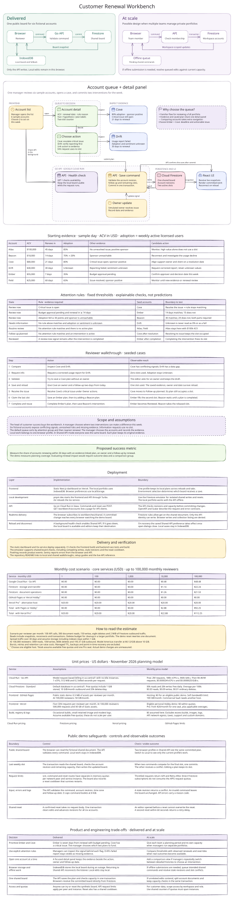

# Customer Renewal Workbench

**TL;DR** — A customer-success manager oversees 40 accounts and can personally help two this week. This workbench brings renewal dates, usage and support notes into one queue so the manager can choose two accounts, record the evidence and assign each follow-up to an owner.

This Hacker Eval prototype uses six fictional B2B software accounts. The buyer is the head of Customer Success. The app simulates the account owner’s follow-through.

**Try the prototype** — [Open the dashboard](http://127.0.0.1:3000/dashboard) or [open the account queue](http://127.0.0.1:3000/dashboard/account-queue). Start with a fresh browser profile for the original six cases. Changes are saved in this browser and survive a reload. Open an account from the queue. The Accounts card on the dashboard also opens the same detail.

[Editable project plan](docs/PLANS/0-START/plan.excalidraw) · [Estimated monthly costs by user count](docs/COST/README.md)



## Starting portfolio

The prototype opens with six synthetic accounts. Annual contract value (ACV) is in USD. Renewal days are relative to the fixed sample day of November 23, 2026. Adoption is the percentage of licensed users active that week.

| Account | ACV | Renews in | Weekly adoption | Other evidence |
| --- | ---: | ---: | --- | --- |
| Atlas | $100,000 | 45 days | 85% | No unresolved issue. Positive sponsor. |
| Beacon | $18,000 | 14 days | Fell from 70% to 20% | Sponsor unreachable. |
| Cove | $80,000 | 21 days | 80% | One critical issue open. Positive sponsor. |
| Drift | $40,000 | 30 days | Unknown | Usage reporting failed. Sponsor sentiment is unknown. |
| Ember | $55,000 | 7 days | 35% | Sponsor says budget approval is pending. |
| Field | $25,000 | 60 days | 65% | Issue resolved. Positive sponsor. |

## How the manager chooses two interventions

One defensible choice is **Ember and Cove**. Ember renews in seven days, and the sponsor has identified a specific dependency. Its owner can identify the budget approver and confirm the decision date. For Cove, the owner can agree on a resolution date with support and schedule an update with the sponsor. Beacon is the closest alternative. Its drop in usage and unreachable sponsor warrant investigation, but the cause of that drop is unknown. The manager can choose Beacon and record their reasoning.

Cove illustrates three distinct things the interface should show together:

| What the manager sees | Example |
| --- | --- |
| Signal | A critical issue is open. Adoption is 80%, and the sponsor is positive. |
| Hypothesis | The unresolved issue could delay renewal. The sponsor has yet to confirm its effect. |
| Agreed plan | Once agreed, record “coordinate issue resolution,” assign an owner, and set a follow-up for two days after the sample day. |

**Capacity rule:** A committed intervention occupies one weekly slot per account. Editing its owner or date keeps the same slot. An information request records an evidence gap and leaves the slot available. Resolving a concern updates the attention reason; the owner explicitly completes the plan to release the slot. This keeps the evidence and the commitment independently visible.

## Reviewer walkthrough and acceptance checks

Start the local frontend and open the account queue in a fresh browser profile.

1. Inspect **Cove**. Its critical issue, 80% adoption and positive sponsor are visible together. Compare **Drift**, whose usage report failed. Request information for Drift, enter “Corrected weekly usage report” and save. The count stays at zero.
2. Open Cove and choose **Plan intervention**. Try saving without an owner, then with a date after renewal. Verify the errors and retained draft. Choose **Coordinate issue resolution**, enter Sam and November 25, 2026, and save. The count becomes one. Reload and reopen Cove. Its action, owner, date and supporting signal should still be visible.
3. Under **Account owner simulation**, resolve Cove’s issue. Its attention status changes to **Monitoring** while the follow-up remains. The current signal shows the resolution while the agreed plan retains the evidence from the time it was saved. Completing the plan releases the slot and the status becomes **No intervention**.
4. Commit the second slot to **Ember** with **Confirm budget approval**. Try saving a Beacon intervention. The app should explain that both slots are occupied. Editing Ember uses the same slot. Completing its intervention releases one.
5. With one slot free, open Ember and Beacon in separate tabs of the same browser. Submit valid interventions from both. Exactly one should save. An independent browser profile should see a fresh portfolio.
6. Search for an absent account or filter by attention. Use **Clear filters** to recover from an empty result. Check keyboard operation, Escape to close the modal and focus returning to its opener.

## Decision rules

An open critical issue warrants review. Pending budget approval warrants review when renewal is within 14 days inclusive. A decline of at least 30 percentage points in adoption warrants review when the sponsor is also unreachable. If no review rule matches, missing usage or sentiment prompts an information request. An account with an open intervention is **Monitoring**. The others, including Atlas, are **No intervention**. Within each attention group the queue sorts by earliest renewal. Contract value is not a tie-breaker. The manager chooses the interventions.

## Engineering choices and scope

The frontend is a Next.js App Router workbench with React, an English next-intl catalog and selected shadcn-admin components. Its dashboard and account list share a detail dialog. Comparing accounts requires opening each detail in turn. That trade-off keeps the main workflow small enough to finish and verify within the exercise.

The frontend runs locally and supports static export. IndexedDB persists records by account. Each write reads current commitments and updates the plan in one transaction. Two tabs therefore share a single weekly limit. A revision check rejects stale edits, and tabs refresh after a change. If browser storage is unavailable, writes are disabled and the draft can be retried. The synthetic week is fixed so the reviewer can reproduce the cases.

Browser persistence keeps the walkthrough independent of backend setup. Clearing site data resets it. Another device or profile has a separate portfolio. The Go API and Firestore in the design diagram are a possible later phase for shared data across devices.

The exercise uses synthetic data and explainable attention rules. Live analytics, actual outreach, support and CRM integrations, churn prediction, paid AI features, billing, and production account management are outside the prototype scope.

## Proposed success metric

**Share of accounts renewing within 30 days that have a timely, evidence-backed intervention.** Count each account once. Include it in the numerator when a plan was saved before renewal, links to a specific signal, names an owner, and schedules follow-up by the renewal date. In the starting portfolio the denominator is four: Beacon, Cove, Drift, and Ember. For a real reporting period, compare plan creation timestamps and follow-up dates with each renewal date. A point-in-time metric would also need plan history. The prototype stores the latest plan and uses a fixed sample day, so it does not report a measured business result. It measures planning coverage. Assessing whether an intervention improved renewal outcomes would require actual outcomes and a credible comparison.

## Setup, verification, and submission

Run the frontend locally with Node.js 22.12+ and pnpm 10.

```sh
cd frontend/web
pnpm install --frozen-lockfile
pnpm dev
```

Run `pnpm typecheck`, `pnpm test`, and `pnpm build` from the same directory. The static build is written to `out/`. `pnpm test` checks the attention rules, the slot limit, an information request, a missing owner, and Cove after the issue is resolved.

### Verification

The project author personally checked the frontend.

Codex ran `pnpm typecheck`, `pnpm test`, and `pnpm build` locally. All three passed. Its scripted headless Chrome walkthrough on a fresh profile opened the account queue and checked all six seeded rows, Drift’s unknown usage and information request, Cove’s conflicting signals, a missing owner, a follow-up after renewal, save and reload, issue resolution to Monitoring, focus returning to Cove, a third intervention rejected at capacity, and empty-search recovery. The rule tests also check that editing an existing plan keeps the same slot. A two-tab race, Safari, Firefox, a physical phone, and a screen-reader pass were not repeated in this check.

AI assistance covered interface alternatives, the architecture diagram, implementation, documentation and scripted verification. The author directed the dashboard layout, modal behavior, theme options and phased frontend-first approach.

[Local prototype](http://127.0.0.1:3000/) · [Public repository](https://github.com/velrino/customer-renewal-workbench)

## Reviewing with an AI assistant

Open [AGENTS.md](AGENTS.md) for project instructions and links to the review skills. Any reviewer can follow them as plain Markdown.
