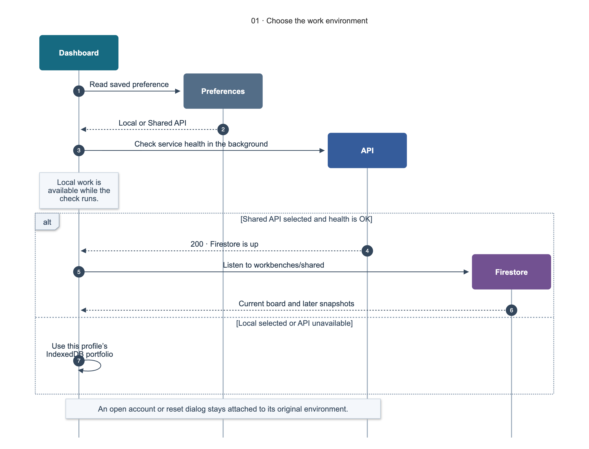

# 01 · Choose the work environment

The dashboard reads the saved environment preference and checks API health in the background. When Shared API is selected and available, Firestore supplies the portfolio. An open editor keeps the environment in which it was opened.

[Editable Mermaid source](SEQUENCE.txt)
