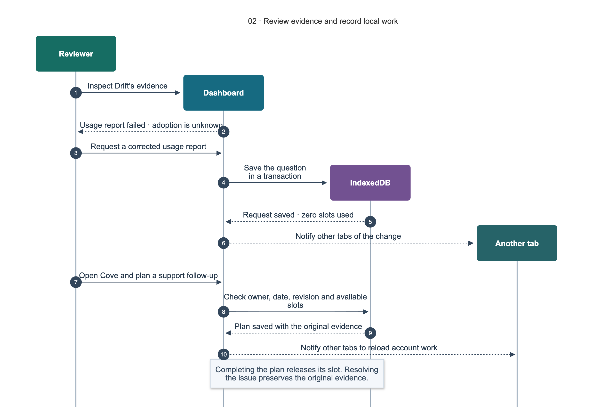

# 02 · Review evidence and record local work

The reviewer requests a corrected usage report for Drift, then saves a support intervention for Cove. The information request uses no weekly slot. The intervention takes one, and another tab can reload the saved work.

[Editable Mermaid source](SEQUENCE.txt)
