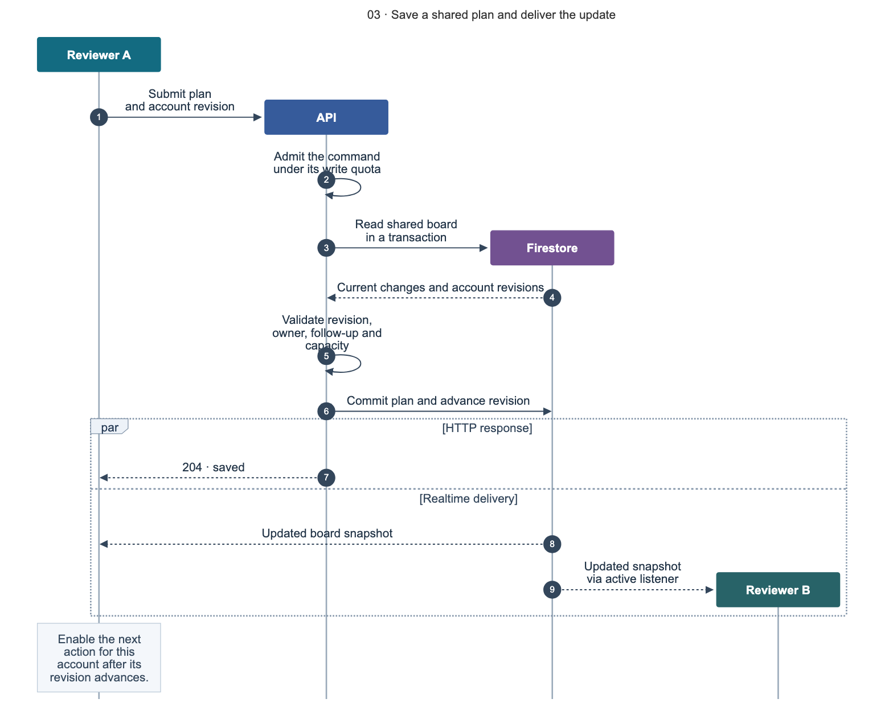

# 03 · Save a shared plan and deliver the update

Reviewer A submits an account revision with a plan. The API validates and commits it in a Firestore transaction. Both subscribed reviewers receive the updated board. The writer waits for the new account revision before enabling another action on that account.

[Editable Mermaid source](SEQUENCE.txt)
