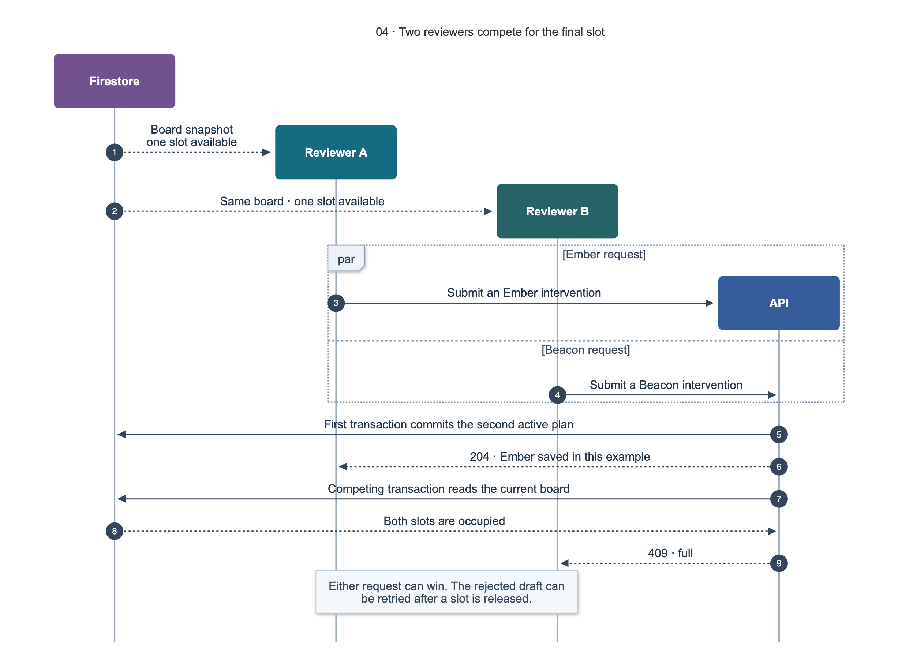

# 04 · Two reviewers compete for the final slot

Two reviewers see one available slot and submit interventions for different accounts. The first successful transaction takes the slot. The competing request receives a conflict and its draft can be retried.

[Editable Mermaid source](SEQUENCE.txt)
