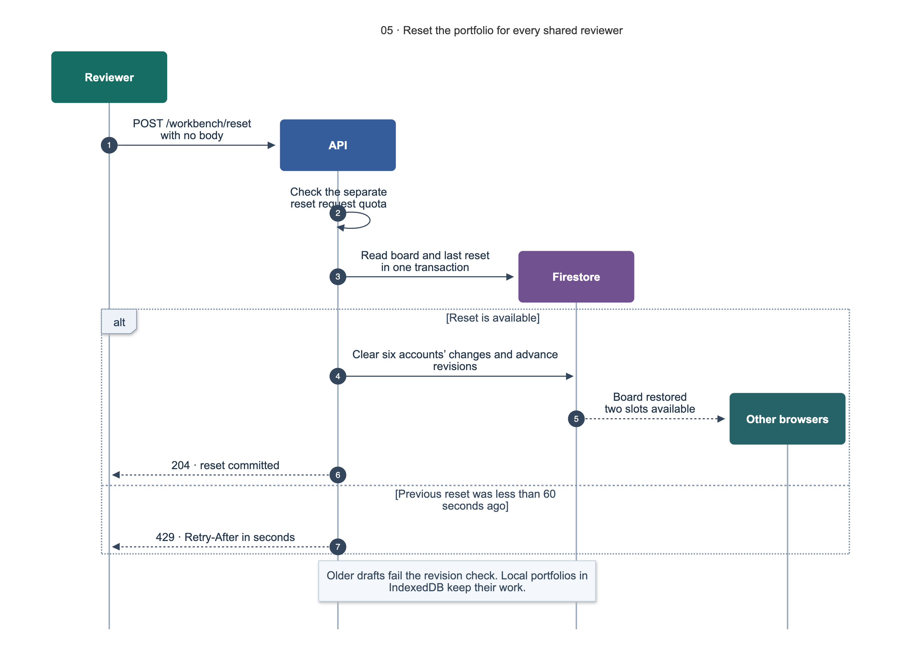

# 05 · Reset the portfolio for every shared reviewer

A reviewer confirms a shared reset. The API checks its quota and the time of the previous reset. A successful reset restores the six accounts for all subscribers and invalidates older drafts.

[Editable Mermaid source](SEQUENCE.txt)
