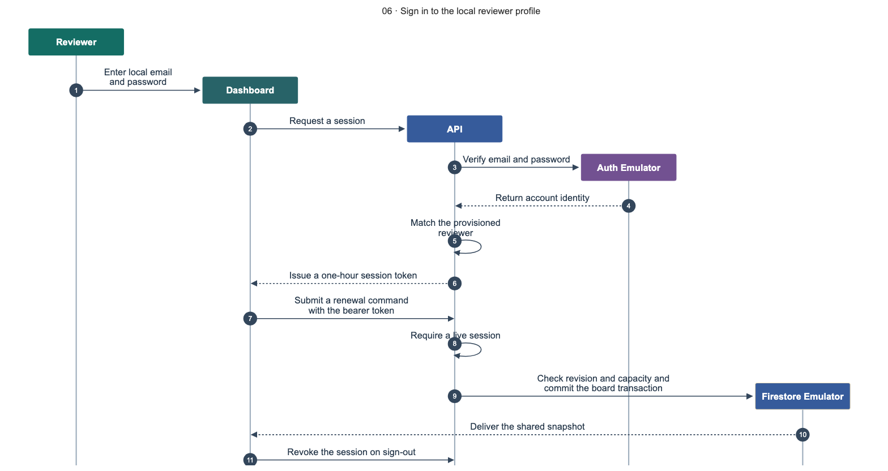
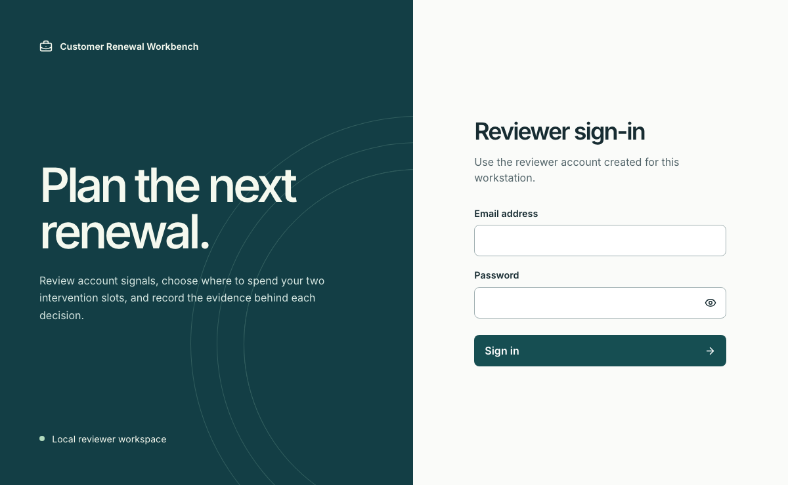

# 06 · Sign in to the local reviewer profile

The dashboard sends the password to the loopback API. The API checks it with the Firebase Authentication Emulator and verifies the provisioned reviewer ID before issuing a one-hour bearer token. Each list, command and reset requires a live session. A missing or expired token returns HTTP 401 before the renewal handler runs.

The tab holds its token in memory. Refreshing the page requires a fresh sign-in. Sign-out revokes that session on the API. Other tabs sign in independently. The shared board still arrives through a Firestore listener, pointed at the local emulator.

[Editable Mermaid source](SEQUENCE.txt)

### Dashboard entry

